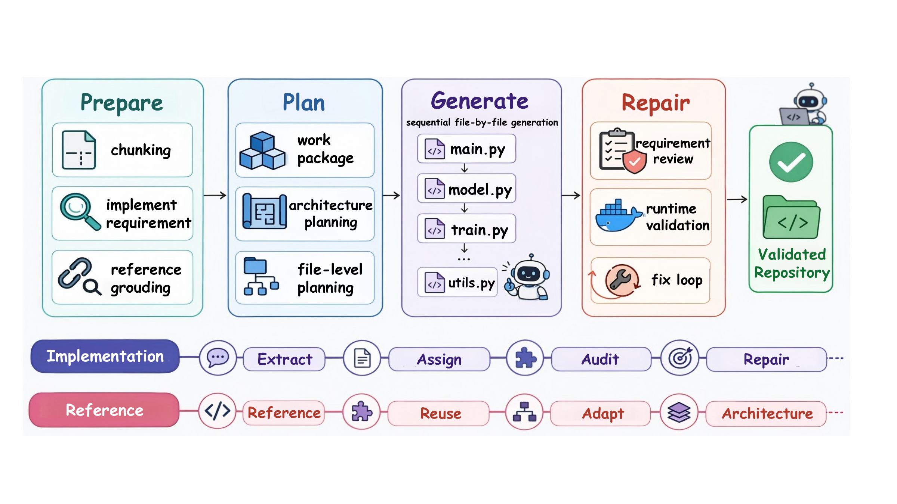
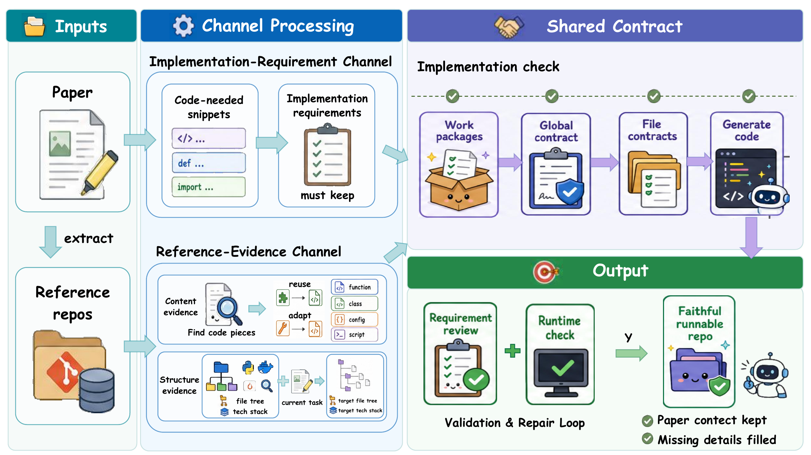

# ReproAgent：Contract-Guided Paper-to-Code Reproduction

<p align="center">
  <a href="https://arxiv.org/abs/2608.24291"></a>
  &nbsp;&nbsp;&nbsp;
  <a href="https://github.com/kernel-14/ReproAgent"></a>
  &nbsp;&nbsp;&nbsp;
  <a href="LICENSE"></a>
</p>

## 1. Overview

Paper-to-code reproduction asks an agent to turn a research paper into an executable repository that preserves its method, protocol, metrics, and artifacts. The specification is split across the paper and the surrounding research ecosystem: algorithms and evaluation requirements may be stated explicitly, while framework defaults, file organization, entry points, and implementation conventions often remain implicit. Long generation trajectories can lose the explicit requirements, and model priors alone are unreliable for recovering the implicit details.

ReproAgent treats reproduction as contract-guided repository construction. It extracts paper-derived code obligations, grounds implicit choices with evidence from related repositories, and carries both forms of information through planning, file generation, validation, and repair. The result is a runnable repository that can be inspected against the paper's requirements instead of being judged only by whether it executes.



## 2. Method

ReproAgent uses a persistent implementation contract with two complementary channels:

- **Implementation-requirement channel**: converts paper snippets into concrete obligations for algorithms, losses, datasets, training settings, metrics, and artifacts.
- **Reference-evidence channel**: retrieves content and structure evidence from related repositories to ground implementation details, interfaces, file layout, and entry points.

The contract is organized into work packages and projected into file-level contracts. Each generated file has declared responsibilities, interfaces, evidence, artifacts, and validation checks. The four stages are:

1. **Prepare** segments the paper, extracts implementation requirements, and builds a reference-repository index.
2. **Plan** binds requirements to evidence, work packages, architecture, and file contracts.
3. **Generate** writes the repository file by file in dependency order and records implementation provenance.
4. **Repair** checks requirement coverage and runtime behavior, then applies bounded, targeted fixes.



## 3. Quick Start

Create an environment and install dependencies:

```bash
python -m venv .venv
. .venv/bin/activate
pip install -r requirements.txt
```

Create a local environment file and fill in the model endpoint variables:

```bash
cp .env.example .env
```

At minimum, configure the node and structured-stage model settings:

```bash
PAPERBENCH_REPRO_NODE_MODEL=gemini-3-flash-preview
PAPERBENCH_REPRO_NODE_API_KEY=...
PAPERBENCH_REPRO_NODE_BASE_URL=...
PAPERBENCH_REPRO_STRUCTURED_STAGE_MODEL=gemini-3-flash-preview
PAPERBENCH_REPRO_STRUCTURED_STAGE_API_KEY=...
PAPERBENCH_REPRO_STRUCTURED_STAGE_BASE_URL=...
```

Place PaperBench-style cases under `paperbench_data/<paper-id>/`, or pass an explicit data root. Run one case through generation and repair:

```bash
python run_paperbench.py rice --stage repair
```

Run only through repository generation:

```bash
python run_paperbench.py rice --data-root /path/to/paperbench_data --stage generate
```

Outputs are written to `output/reproagent/<run-id>/`. The PaperBench benchmark and data format are documented in the [PaperBench repository](https://github.com/openai/frontier-evals/tree/main/project/paperbench).

## 4. Experiments and Findings

We evaluate on PaperBench Code-Dev, a 20-task suite of ICML 2024 paper-reproduction problems. Scores are macro-averaged percentages; higher is better.

### Full-Suite Comparison

| System | Backbone / setting | Mean score |
| --- | --- | ---: |
| PaperCoder | reported setting | 45.1 |
| AutoP2C | reported setting | 49.2 |
| AutoReproduce | reported setting | 49.6 |
| Deep-Reproducer | reported setting | 63.2 |
| DeepCode | reported setting | 73.5 |
| **ReproAgent** | **Claude-Sonnet-4.5** | **73.7** |

### Same-Backbone Comparison

All systems use Gemini-3-Flash in this controlled comparison.

| System | Mean score |
| --- | ---: |
| BasicAgent | 19.3 |
| IterAgent | 20.6 |
| AiScientist | 30.5 |
| **ReproAgent** | **39.7** |

### Channel Ablations

| Setting | Mean | Median | Drop from full |
| --- | ---: | ---: | ---: |
| Full contract | 39.7 | 41.8 | - |
| Without reference evidence | 21.6 | 21.4 | -18.1 |
| Without implementation requirements | 25.6 | 24.6 | -14.1 |

The full contract achieves the best mean score among same-backbone scaffolds under both Claude-Sonnet-4.5 and Gemini-3-Flash. It also outperforms both channel ablations on all 20 targets. The results show that the two channels are complementary: the requirement channel preserves paper-specific obligations, while the evidence channel grounds repository-level implementation choices.

Per-paper scores, ablation outputs, generated repositories, and supporting artifacts are stored on the [`experiment` branch](https://github.com/kernel-14/ReproAgent/tree/experiment).

## 5. Repository Architecture

```text
reproagent/                 Core Python package and pipeline implementation.
  pipeline/
    nodes/                  Prepare, Plan, Generate, and Repair stages.
    utils/                  Planning, evidence, generation, validation, and storage utilities.
    paperbench_cli.py       PaperBench command-line entry point.
ablation/                   Runners for the two channel ablations.
experiment_runners/         Batch runners for the full and ablated settings.
fig/                        Architecture and pipeline figures.
run_paperbench.py           Top-level CLI entry point.
requirements.txt            Python dependencies.
.env.example                Environment-variable template.
```

The `main` branch contains the source code and documentation. The [`experiment` branch](https://github.com/kernel-14/ReproAgent/tree/experiment) contains experiment data and generated outputs.

## 6. Citation

```bibtex
@article{hu2026reproagent,
  title         = {ReproAgent: Contract-Guided Paper-to-Code Reproduction},
  author        = {Hu, Xue and Pan, Zewei and Wang, Zhongyuan and Liu, Zhou and Su, Zeli and Zhang, Wentao},
  journal       = {arXiv preprint arXiv:2608.24291},
  year          = {2026},
  doi           = {10.48550/arXiv.2608.24291},
  url           = {https://arxiv.org/abs/2608.24291}
}
```

## 7. License

ReproAgent is released under the [MIT License](LICENSE).
